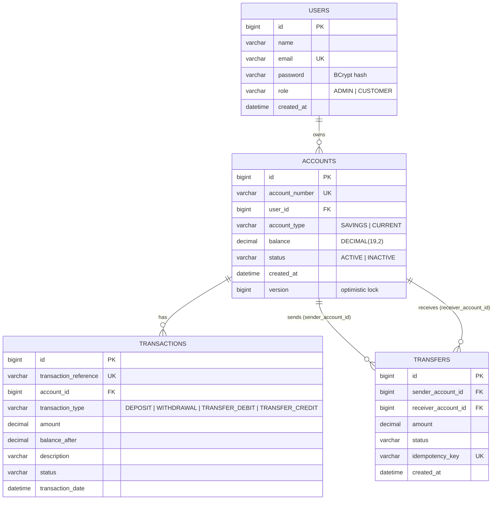

# Banking Management System

An educational banking simulation built with **Java 17, Spring Boot 3.3, Spring Security (JWT), Spring Data JPA, MySQL and Swagger/OpenAPI**.
It does not integrate with any real banking or payment system.

## Features

**Customer:** register, log in, open accounts, check balance, deposit, withdraw, transfer between accounts, view paginated and filterable transaction history.
**Admin:** list users and accounts, activate or deactivate accounts, monitor all transactions.

## Architecture

```
com.banking
├── controller   REST endpoints (thin: validate, delegate, return status codes)
├── service      Business rules + @Transactional boundaries
├── repository   Spring Data JPA interfaces
├── entity       JPA entities and enums
├── dto          Request/response records (entities are never exposed)
├── security     JWT service, auth filter, UserDetails
├── config       SecurityConfig, OpenAPI, admin seeder
└── exception    Custom exceptions + GlobalExceptionHandler
```

## Database design (ER diagram)



**Relationships:** one user has many accounts; one account has many transactions; a transfer links two accounts and produces two transaction rows (a debit on the sender, a credit on the receiver).
Two columns were added beyond the brief: `transactions.balance_after` (statement-style history) and `transfers.idempotency_key` (duplicate-transfer protection).

## Key design decisions (good interview material)

| Topic | Decision |
|---|---|
| Money | `BigDecimal` everywhere, `DECIMAL(19,2)` in MySQL, amounts validated to max 2 decimals. |
| Atomic transfers | `@Transactional` on the service method; any exception rolls back both debit and credit. |
| Concurrency | `SELECT ... FOR UPDATE` (pessimistic lock) on both accounts, always locked in ascending id order to avoid deadlocks. `@Version` is a second safety net. |
| Duplicate transfers | Optional `idempotencyKey`: replaying the same key returns the original transfer instead of moving money twice. |
| Security | Stateless JWT, BCrypt, role rules in `SecurityConfig`, ownership checks in services, no password in any response, same error for unknown email and wrong password. |
| Admin accounts | Public registration only creates CUSTOMERs; the first ADMIN is seeded from environment variables. |
| Errors | One `GlobalExceptionHandler` returning a consistent `ApiError` JSON (400/401/403/404/409/422). |
| Secrets | Everything sensitive comes from environment variables; `.env` is git-ignored. |

## Run it

Prerequisites: JDK 17+, Maven 3.9+, MySQL 8.

1. Set environment variables (see `.env.example`): `DB_USERNAME`, `DB_PASSWORD`, `JWT_SECRET` (32+ chars), and optionally `ADMIN_EMAIL` / `ADMIN_PASSWORD` to seed an admin.
2. Start MySQL (the database `banking_db` is created automatically).
3. `mvn spring-boot:run`
4. Open Swagger UI at `http://localhost:8080/swagger-ui.html`, log in, click **Authorize** and paste the token.

Run tests: `mvn test`

## API summary

| Method | Endpoint | Access |
|---|---|---|
| POST | `/api/auth/register` | Public |
| POST | `/api/auth/login` | Public |
| POST | `/api/accounts` | Authenticated |
| GET | `/api/accounts/my-accounts` | Authenticated |
| GET | `/api/accounts/{id}` | Owner or admin |
| GET | `/api/accounts/{id}/balance` | Owner or admin |
| POST | `/api/transactions/deposit` | Account owner |
| POST | `/api/transactions/withdraw` | Account owner |
| POST | `/api/transactions/transfer` | Sender account owner |
| GET | `/api/transactions/history/{accountId}?type=&page=&size=&direction=` | Owner or admin |
| GET | `/api/transactions/reference/{reference}` | Owner or admin |
| GET | `/api/admin/users` | Admin |
| GET | `/api/admin/accounts` | Admin |
| PUT | `/api/admin/accounts/{id}/status` | Admin |
| GET | `/api/admin/transactions?type=&page=&size=&direction=` | Admin |

## Try it with curl

```bash
# Register and log in
curl -X POST localhost:8080/api/auth/register -H 'Content-Type: application/json' \
  -d '{"name":"Asha","email":"asha@example.com","password":"Passw0rd123"}'
TOKEN=$(curl -s -X POST localhost:8080/api/auth/login -H 'Content-Type: application/json' \
  -d '{"email":"asha@example.com","password":"Passw0rd123"}' | jq -r .token)

# Open an account with an initial deposit
curl -X POST localhost:8080/api/accounts -H "Authorization: Bearer $TOKEN" -H 'Content-Type: application/json' \
  -d '{"accountType":"SAVINGS","initialDeposit":1000.00}'

# Transfer (idempotencyKey makes retries safe)
curl -X POST localhost:8080/api/transactions/transfer -H "Authorization: Bearer $TOKEN" -H 'Content-Type: application/json' \
  -d '{"fromAccountId":1,"toAccountId":2,"amount":250.50,"description":"Rent","idempotencyKey":"7b0c1f9e-0001"}'
```

## Ideas to extend it

- Integration tests with Testcontainers (MySQL) including a concurrent-transfer test.
- Flyway migrations instead of `ddl-auto=update`.
- Refresh tokens, login rate limiting, account lockout.
- Dockerfile + docker-compose (app + MySQL) and a GitHub Actions CI workflow.

## Frontend

A React + Vite + Tailwind client lives in [`frontend/`](frontend/README.md). Start the backend, then `cd frontend && npm install && npm run dev`.
